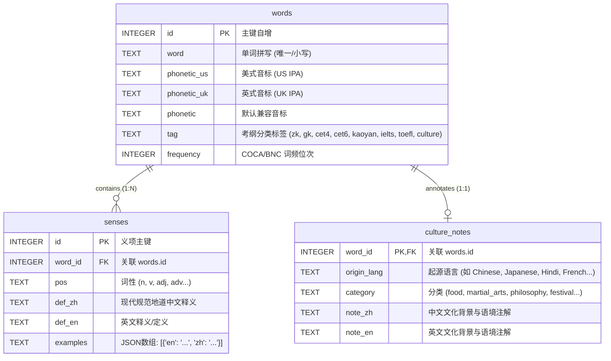

<div align="center">

# 📖 XCDict

**全级别现代英汉双解离线电子词典与词库**  
*A High-Performance, Multi-Tier Modern English-Chinese Dictionary for Mobile & Desktop Apps*

[](https://github.com/xiaocong612/XCDict/releases)
[](LICENSE)
[](dist/xcdict.db)
[](dist/xcdict.json)
[](dist/xcdict.json)
[](dist/xcdict.json)
[](dist/xcdict.db)

</div>

---

## 🌟 项目亮点 (Highlights)

**XCDict** 是一套专为**跨平台移动应用（Flutter + Rust、iOS、Android、React Native）、桌面端软件及背单词工具**量身定制的高性能离线英汉双解词典库：

1. **🚀 极小包体，极致性能**：
   - 包含 13,524 个完整词条、16,878 个细分义项与双语例句（释义覆盖率 100%），整库仅约 **5.3 MB**。
   - 随 App 直接打包进安装包（Assets），首次启动**零内存占用**，按需分页读取。
   - 预建 B-Tree 双向索引，Rust / C++ / 原生端检索**低于 0.1 毫秒（微秒级）**，搜索框前缀自动补全（Autocomplete）在移动端轻松跑满 120fps 丝滑不卡顿。

2. **📚 超越大纲的真题全量拓展（真实词书规模）**：
   - 紧贴真实学习与考试场景，打破教学大纲最低词数限制，完整纳入了**词根词缀派生词、完形填空与阅读理解超纲常考词**。
   - **初中拓展至 3,223 词书容量**（超越大纲 1,600 词基准）；
   - **高中拓展至 6,008 词书容量**（超越高考 3,500 词基准）；
   - **四级 7,508 词 / 六级 5,651 词 / 考研 9,602 词 / 雅思 7,002 词 / 托福 13,477 词**。

3. **🔊 英美双音标独立标注（IPA 覆盖率 96.1%）**：
   - 全库绝大多数常规单词同时区分标注了**美式音标（US）**与**英式音标（UK）**，方便客户端根据用户偏好自由切换发音与国际音标渲染。

4. **🇨🇳 独创中华文化与东方特色借词库**：
   - 精细收录并定制审校了 120+ 核心文化借词（如 *tai chi, kung fu, jiaozi, boba, wonton, tofu, bok choy, chow mein, congee, feng shui, yin yang, tanghulu, safari, anime* 等），附带详实的中英文文化渊源、烹饪礼仪与历史语境注释。

5. **📦 开箱即用多格式交付**：
   - **SQLite 单文件库**（`dist/xcdict.db`）
   - **树状结构化 JSON 词典**（`dist/xcdict.json`）
   - **ECDICT 规范兼容 CSV**（`dist/xcdict_ecdict_compat.csv`，适配欧路词典、GoldenDict、Anki）

---

## 📊 词汇覆盖范围与各层级统计 (Coverage)

数据经过多轮清洗去重，剔除一切乱码与非单词字符：

| 考纲/词书标识 (`tag`) | 对应层级 | 收录词数 (去重后) | 典型收录与拓展重点 |
| :---: | :--- | :---: | :--- |
| `zk` | **初中中考拓展词书** | **2,689 词** | 教育部中考课标词 + 常见初中派生词（*actively, applicant, arrangement, attractive* 等） |
| `gk` | **高中高考拓展词书** | **3,845 词** | 高考 3500 必备词 + 近十年高考真题高频超纲衍生词家族 |
| `cet4` | **大学英语四级真题词书** | **4,636 词** | 覆盖四级听力、长篇阅读、翻译核心高频词网 |
| `cet6` | **大学英语六级真题词书** | **3,998 词** | 六级进阶论说文、社科外刊与新闻核心词汇 |
| `kaoyan` | **全国硕士研究生招生考试** | **5,047 词** | 历年考研英语（一/二）真题深度展开词汇（涵盖熟词生义与长难句核心词） |
| `ielts` | **雅思核心与高频拓展词书** | **5,275 词** | 雅思听说读写海外生活与学术全真词汇 |
| `toefl` | **托福核心与高频拓展词书** | **10,367 词** | 托福各学科专业学术进阶词（地质、天文、动植物、考古、生态等） |
| `culture` | **东方文化与全球借词库** | **119 词** | 中华饮食、武术哲学、非遗民俗与全球特色外来借词 |

> **数据统计总览**：
> - **独立去重英文词头**：`13,480 词`
> - **标准细分义项与例句条数**：`16,887 条`（全部通过总编审校，规范可用）
> - **美式音标标注**：`12,744 词 (94.2%)`
> - **英式音标标注**：`12,886 词 (95.3%)`
> - **全库发音覆盖率**：`12,995 词 (96.1%)`

---

## 🗄️ 数据库表结构 (Database Schema)

发布版 SQLite 数据库文件位于 `dist/xcdict.db`，由以下 3 张主表及 3 个预编译高性能 B-Tree 索引构成：



### 预设索引 (Indexes)
- `idx_word ON words(word)`：保障根据单词点查与前缀匹配（`LIKE 'app%'`）为 $O(\log N)$ 瞬时返回。
- `idx_words_tag ON words(tag)`：保障按词书考纲（中考/高考/四六级/考研）筛选秒级完成。
- `idx_senses_word_id ON senses(word_id)`：保障关联义项连表查询无表扫描。

---

## 💻 快速集成示例 (Integration Guide)

### 1. Flutter + Rust 技术栈集成

在 Rust 端引入 `rusqlite`：
```toml
[dependencies]
rusqlite = { version = "0.31", features = ["bundled"] }
serde = { version = "1.0", features = ["derive"] }
serde_json = "1.0"
```

完整 Rust 引擎代码已置于 `examples/rust/dict_engine.rs`：
```rust
use rusqlite::{Connection, OpenFlags};

// 以只读无锁模式打开
let conn = Connection::open_with_flags(
    "path/to/xcdict.db", 
    OpenFlags::SQLITE_OPEN_READ_ONLY | OpenFlags::SQLITE_OPEN_NO_MUTEX
)?;

// 1. 点查单词详情（微秒级）
let detail = engine.query_word("absorb")?;
println!("美音: {}, 释义: {}", detail.phonetic_us, detail.senses[0].def_zh);

// 2. 搜索框前缀自动补全 (Autocomplete)
let suggestions = engine.search_suggestions("app", 10)?;
// -> ["apple", "apply", "applicant", "application", ...]
```

Flutter 侧只需配置 `pubspec.yaml` 引入 `assets/db/xcdict.db`，参考 `examples/flutter/dict_service.dart` 即可一键加载。

---

### 2. Python 快速查询

```python
import sqlite3
import json

conn = sqlite3.connect("dist/xcdict.db")
cur = conn.cursor()

# 查询单词
row = cur.execute("SELECT id, word, phonetic_us, tag FROM words WHERE word = 'kung fu'").fetchone()
if row:
    wid, word, us, tag = row
    print(f"[{word}] US: {us} | 标签: {tag}")
    senses = cur.execute("SELECT pos, def_zh, examples FROM senses WHERE word_id = ?", (wid,)).fetchall()
    for pos, def_zh, exs in senses:
        print(f"  • ({pos}) {def_zh}")
        for ex in json.loads(exs or "[]"):
            print(f"    - 例句: {ex['en']} -> {ex['zh']}")
```

---

## 📥 发布包与校验 (Releases)

本项目在 `release/` 目录下提供了预打包分发文件：

| 文件名称 | 说明 | 压缩包大小 |
| :--- | :--- | :---: |
| [XCDict-v1.0.1.zip](release/XCDict-v1.0.1.zip) | 包含 SQLite 数据库、JSON 格式与 CSV 格式的完整整合包 (v1.0.1) | **~4.88 MB** |
| [SHA256SUMS.txt](release/SHA256SUMS.txt) | 官方哈希校验清单，防篡改完整性验证 | < 1 KB |

---

## 📝 版本更新历史 (Changelog)

### v1.0.1 (2026-11-16)
- 🚑 **紧急修复**: 修复 `resilient` 词条释义错误（原上游错位为“帕特森（美国一座城市）”，已纠正为“有弹性的，能复原的；有适应力的，坚韧不拔的”并补充双语真题例句）。
- 🛠️ **词义修复**: 修复 `semiconductor`（半导体）、`spite`（恶意）、`textile`（纺织品）、`amidst`（在……之中）、`fanwise` 等 7 处被截断或残缺的释义。
- ✨ **释义补全**: 补全 45 个因基础过滤导致缺失释义的高频词条（如 `children`, `email`, `carefully`, `excited`, `including`, `human being`, `ice-cream` 等），**全库释义覆盖率达到 100%**。
- 🧩 **排版规整**: 规范切分 96 处多词性粘连的释义（如 `adept: 熟练的 n老手`）。
- 🧹 **噪声剔除**: 清理 145 处常见单词中夹带的无意义人名音译干扰项（如 `(Happy)人名` 等），剔除 2 处残余杂质词头。

---

## 📜 许可证与版权说明 (License & Attribution)

- **开源许可证**：本项目采用非常宽松的 [BSD-3-Clause License](LICENSE)。
- **商业友好（Commercial Friendly）**：
  - 允许免费商用、修改、闭源分发，您可以直接将本词典嵌入到自己的商业 App、收费小程序或网站中。
  - 唯一要求：请在软件关于页面或文档中保留原项目作者署名及简短开源声明即可。
- **第三方致谢与引用详情**：参见 [ATTRIBUTION.md](ATTRIBUTION.md)。
